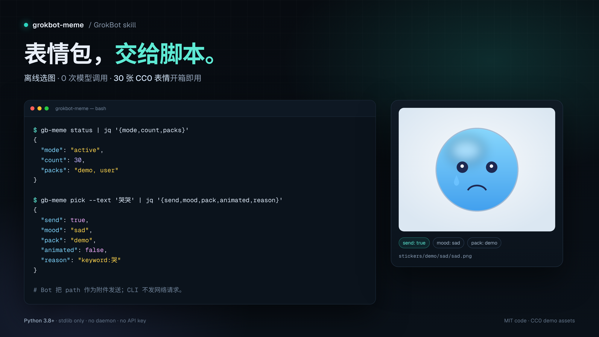
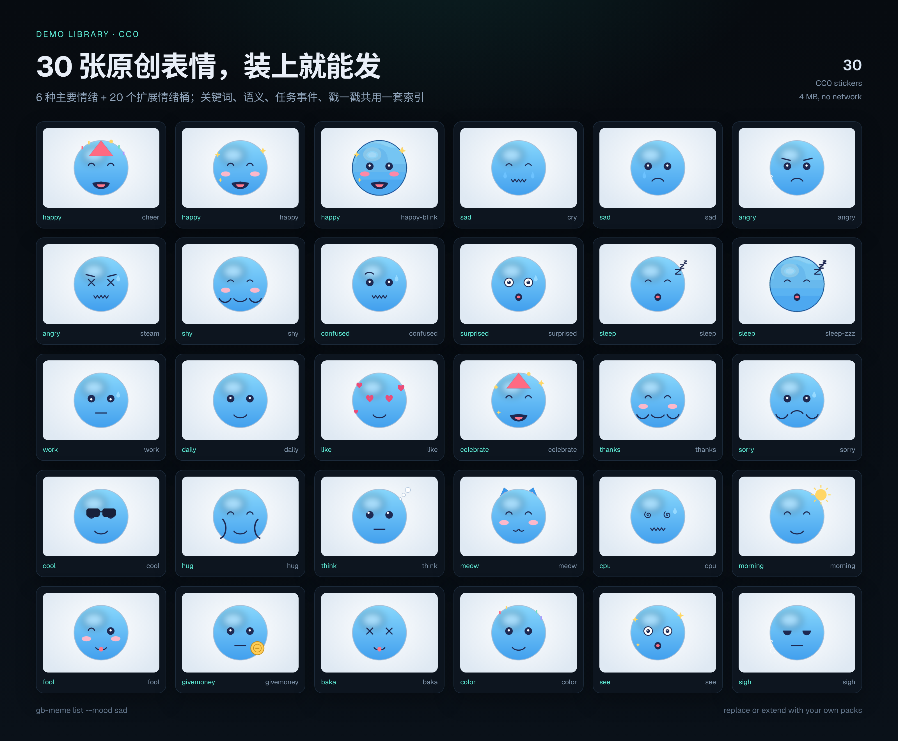

<div align="center">
  
</div>

<h1 align="center">grokbot-meme</h1>

<p align="center">
  <b>给 Grok Bot 的零思考表情包技能。</b><br>
  模型不挑图、不写提示词；脚本按原文、任务事件和情绪选图，返回一行 JSON。
</p>

<p align="center">
  <a href="https://www.python.org/"></a>
  
  <a href="LICENSE"></a>
  
</p>

<p align="center">
  <a href="#快速开始">快速开始</a> ·
  <a href="#装进-grok-bot一步">接入 Grok Bot</a> ·
  <a href="#命令">命令</a> ·
  <a href="#图库">图库</a> ·
  <a href="#配置">配置</a> ·
  <a href="#测试">测试</a>
</p>

---

## 为什么是脚本选图

让模型“想一张表情”会带来三个问题：每轮多一次生成、结果不可复现、限频和去重只能靠提示词。`grokbot-meme` 把这件事变成一次本地函数调用：

- **省 token**：选图、限频、去重、情绪状态全在脚本里，模型不参与决策，也不调用任何模型 API。
- **零运行依赖**：标准库 Python 3.9+，不需要 pip install、不需要常驻服务、不需要数据库。
- **开箱可用**：仓库自带 30 张原创 CC0 演示表情（28 静态 + 2 动图），装完立刻能发；自己的图包一条命令导入。
- **可移植**：索引存相对路径，仓库放哪都能跑；`install.sh` 安装到 `~/.grokbot-meme`，移动或重新 clone 不会失效。
- **可解释**：每次返回 `reason`（`keyword:哭`、`semantic:…`、`event:fail`、`fsm:happy`、`rate_limited`），出问题能直接定位。

## 快速开始

```sh
git clone https://github.com/aritosi/grokbot-meme.git
cd grokbot-meme
./install.sh
```

`install.sh` 会把程序复制到 `~/.grokbot-meme`、建好 `~/.local/bin/gb-meme` 软链，并打印一次 `status`：

```json
{"ok": true, "version": "2.1.0", "mode": "active", "packs": ["demo", "user"], "count": 30, ...}
```

直接试：

```sh
~/.grokbot-meme/bin/gb-meme pick --text '今天好累，想哭'
{"ok": true, "send": true, "mood": "sad", "id": "sad", "pack": "demo", "animated": false,
 "path": "/home/you/.grokbot-meme/stickers/demo/sad/sad.png", "reason": "keyword:哭", ...}
```

> 想换安装位置：`GROKBOT_MEME_HOME=/opt/grokbot-meme ./install.sh`。卸载运行 `./uninstall.sh`。

## 装进 Grok Bot（一步）

安装脚本会在结尾打印技能文件位置。在 Grok Bot 里说一句即可：

> 读取 `~/.grokbot-meme/skill/SKILL.md`，用 UpdateSkill(action="write", id="grokbot-meme") 安装。

之后正常聊天。技能要求 Bot 在每条最终回复前运行 `gb-meme pick --text '<用户原文>'`；`send:true` 时把返回的 `path` 作为附件发给用户，`send:false` 就不发。默认 `active` 模式会持续配图；想只在命中关键词时发，改 `set-mode normal`。

技能文件里的命令是绝对路径，所以 Bot 的 shell 不需要配置 PATH。`~/.local/bin/gb-meme` 只是给人用的快捷方式。

## 效果

真实终端输出（上图）和仓库自带的 30 张 CC0 表情：



## 命令

| 命令 | 作用 |
|---|---|
| `gb-meme status` | 模式、开关、图库数量、运行态摘要 |
| `gb-meme pick [--text T] [--event E] [--force] [--prefer-gif\|--no-gif]` | 选一张图；输出单行 JSON |
| `gb-meme poke` | 戳一戳（等价 `pick --event poke --force`，仍受限频） |
| `gb-meme import <图片...> [--mood M]` | 导入本地图片到 `stickers/user/` |
| `gb-meme import-pack <zip\|目录>...` | 导入图包（`manifest.json` + `memes/<mood>/...`） |
| `gb-meme list [--pack P] [--mood M] [--animated]` | 列出已索引素材 |
| `gb-meme set-mode active\|normal` | 切换配图模式 |
| `gb-meme feature <name> on\|off` | 单独开关语义/动图/事件/情绪粘性/限频/去重/poke |
| `gb-meme rebuild-index` | 重建索引（新增/删除文件后） |
| `gb-meme reset-runtime` | 清冷却、去重窗和情绪状态，不动图库 |

失败时仍输出单行 JSON：`{"ok": false, "error": "..."}`，退出码 1。

### `pick` 输出

```json
{"ok": true, "send": true, "mood": "happy", "id": "cheer", "pack": "demo",
 "animated": false, "path": "/abs/path.png", "reason": "keyword:开心",
 "gates": {"cooldown": false, "min_interval": false, "max_per_hour": false}}
```

`send:false` 的原因：`no_trigger`、`rate_limited`、`deduped`、`disabled`、`no_candidate`。

## 选图优先级

```text
--force > poke/事件映射 > 关键词/语义情绪 > 情绪粘性(FSM) > active 默认 daily > normal 不触发
```

- **关键词**：中英词表 + emoji，命中即定情绪（`data/config.json` 的 `keywords` 可覆盖）。
- **语义**：无模型。归一化文本后做字符 bigram Dice，与素材的 `description + keywords` 比较，超过 `semantic_threshold`（默认 0.12）才采用；否则不猜。
- **事件映射**：`start/working → work|cpu`，`success/done → celebrate|happy|like`，`fail/error → sad|angry|confused`，`wait/idle → daily|sleep`，`poke → shy|meow|surprised|happy`（轮换），见 `data/actions.json`。
- **情绪粘性**：连续同情绪最多 `fsm_stickiness` 次，避免表情乱跳。
- **动图**：同情绪下优先 GIF（`prefer_animated` / `--prefer-gif`），没有就回退静态。
- **去重**：最近 `dedupe_window` 次用过的 id / 路径 / 内容哈希跳过；候选耗尽自动放宽，不会因为图少而发不出。

## 限频

默认：最短间隔 3 秒、同情绪冷却 8 秒、每小时最多 40 张。超限返回 `send:false, reason:"rate_limited"`，不抛错、不重试。`--force` 也不能绕过限频。状态保存在 `data/runtime.json`。

## 图库

仓库只带 `stickers/demo`（原创 CC0，30 张）。不附带任何第三方表情包：各平台图包的再分发许可差异很大，需要你自己确认。

导入自己的图包：

```sh
gb-meme import-pack ~/Downloads/my-pack.zip
gb-meme import-pack ./my-pack-dir/
```

图包结构（ZIP 或目录都可以）：

```text
manifest.json            # {"id": "my-pack", "name": "我的表情包"}
memes/
  happy/a.png
  sad/b.gif
  daily/c.webp
index.db                 # 可选：sqlite 表 memes(path, caption, keywords)
```

`path` 是相对 `manifest.json` 的路径；`caption` / `keywords` 会参与语义匹配。没有 manifest 时用文件名作包 id。导入会覆盖同名包并重建索引，重复导入幂等；zip 内路径穿越和符号链接会被拒绝。

`--mood` 可选：`happy angry sad shy confused surprised sleep work daily like fool sigh see cpu morning meow givemoney baka color think celebrate thanks sorry cool hug`。

素材许可与署名由各图包作者决定，本仓库不授予任何第三方素材的再分发权。

## 配置

首次运行生成 `data/config.json`（默认值见 `src/gb_meme.py` 的 `DEFAULT`）：

```json
{
  "mode": "active",
  "packs": ["demo", "user"],
  "features": {"semantic": true, "gif_prefer": true, "task_events": true,
                "emotion_fsm": true, "rate_limit": true, "dedupe": true, "poke": true},
  "cooldown_seconds": 8, "min_interval_seconds": 3, "max_per_hour": 40,
  "dedupe_window": 12, "prefer_animated": true, "fsm_stickiness": 2,
  "semantic_threshold": 0.12
}
```

`features` 深合并；任一开关关闭即退化为对应阶段的旧行为。配置损坏时自动备份为 `config.broken.<时间戳>.json` 并恢复默认。`keywords`/`triggers` 也可覆盖。

## 目录

```text
bin/gb-meme             # 入口（python3）
src/gb_meme.py          # 匹配、选图、限频、导入、索引
skill/SKILL.md          # UpdateSkill 用的技能正文
data/actions.json       # 事件 → 情绪映射
data/index.json         # 相对路径索引（提交在仓库里，装完即用）
stickers/demo/          # 原创 CC0 演示图库
tools/make_demo_pack.py # 可选的演示素材生成器（需要 Pillow，仅开发用）
tests/                  # 15 个用例，临时目录隔离
docs/                   # README 截图
install.sh              # 安装到 ~/.grokbot-meme + PATH 软链
uninstall.sh            # 卸载
```

## 测试

```sh
./tests/run.sh
```

覆盖模式切换、关键词/事件/语义、FSM、GIF 偏好、冷却与小时配额、去重耗尽、图包导入幂等与路径穿越、坏配置恢复、缺索引重建、索引可移植（整体搬家后仍能选图）。

## 已知边界

- 只按 `.gif` 后缀判动图；动画 WebP 按静态处理。
- 语义是字符 bigram，不做词向量；跨语言/长句效果有限，靠关键词兜底。
- `runtime.json` 无并发锁，按单 Bot 单进程使用设计。
- 本工具只选图和记账，真正的附件发送由 Bot（`SendToUser`）完成。

## License

代码 MIT（见 [`LICENSE`](LICENSE)）。演示素材 CC0-1.0（见 [`NOTICE`](NOTICE)）。仓库不包含任何第三方表情包素材。
